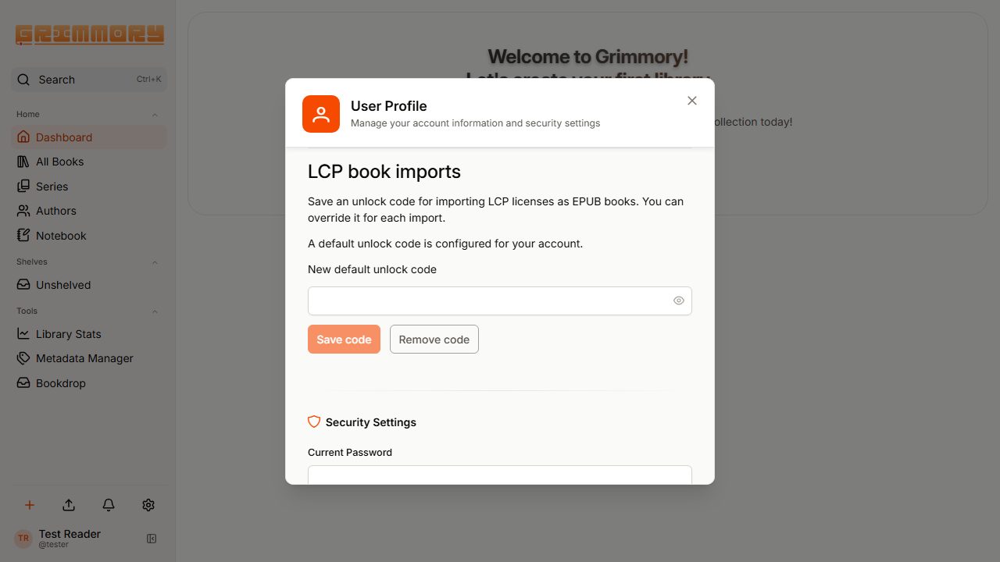
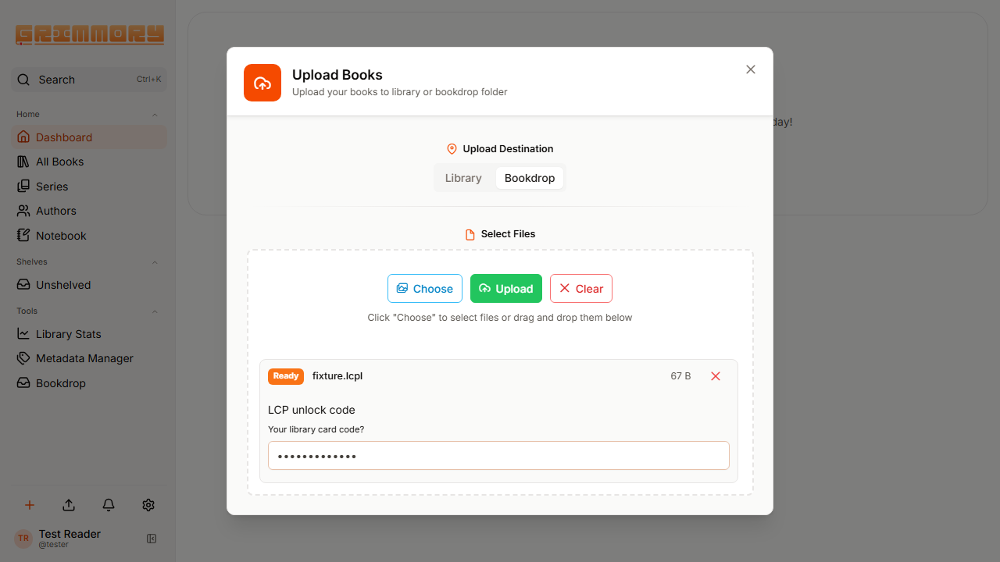
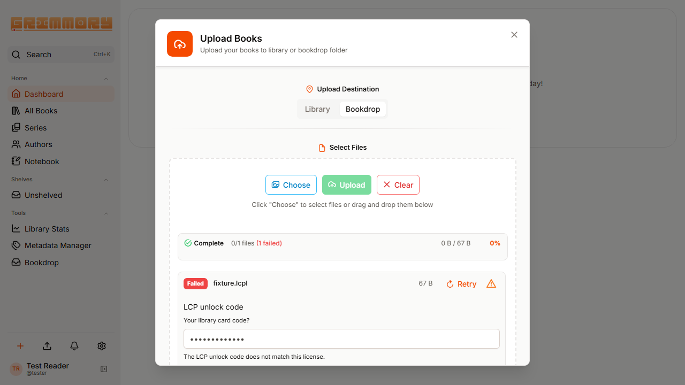

# LCP license imports

The web uploader accepts `.lcpl` licenses and imports their publication as an EPUB through the existing library or BookDrop upload flow.

Conversion removes LCP DRM. The resulting EPUB has no technical expiry and can be retained and read indefinitely after the original library loan ends. It no longer enforces the original license's loan expiry, revocation, or DRM usage restrictions.

Feature discussion: [grimmory-tools #2990](https://github.com/orgs/grimmory-tools/discussions/2990). One motivating use case is importing downloaded eBiblio licenses; eBiblio account access, catalogue browsing, borrowing, renewal, and loan-lifecycle integration are outside this change.

## Reader workflow

1. Open the user profile and optionally save an LCP unlock code under **LCP book imports**.
2. Open **Upload Book**, select a library and path or BookDrop, and choose the `.lcpl` file.
3. If a default is configured, leave the per-file code empty to use it. Otherwise enter the code supplied by the library or bookseller. The license's hint is displayed alongside the input.
4. Upload the file. Grimmory downloads, decrypts, and validates the EPUB before passing it to its normal import pipeline.
5. If the code is incorrect, enter a replacement, select **Retry**, and upload again. The import dialog stays open when a conversion fails.

The code entered during an upload is used only for that import. It does not replace the saved default. Saved defaults can be replaced or removed in the profile.

### Screenshots

These browser captures use a synthetic user and license with mocked API responses.

## Supported scope

- Readium LCP basic and 1.0 encryption profiles; AES-256-CBC with SHA-256 user keys.
- EPUB publications obtained from a `.lcpl` license through an HTTPS download link.
- Browser uploads to a library or to BookDrop. A license placed directly in a watched folder is not processed: the filesystem watcher does not have a submitting user from whom to obtain a code.

Adobe `.acsm`, protected PDFs, other LCP profiles, and direct uploads of already protected EPUBs are outside this change. Ordinary uploads continue through the existing flow.

## Data handling and limits

The original passphrase is not persisted. The account's SHA-256 user key is stored in the existing `user_settings` table and is never included in user DTOs or the LCP settings response. The settings endpoint returns only whether a default exists and always uses the authenticated user's identity. The generic settings endpoint cannot write this internal setting.

The derived key is itself an unlock secret; this is not encryption at rest. Database access and backups must be protected accordingly. No personal default is embedded in the application or test fixtures.

Downloads use a dedicated Spring HTTP client with connection-time IP filtering. It rejects internal, special-purpose, and multicast addresses while preserving the administrator's configured outbound restrictions. Each redirect is checked and must remain HTTPS on port 443; credentials embedded in URLs are rejected. Response length and streamed bytes are limited to the configured upload size, capped at 512 MB.

The converter bounds archive entry counts, individual resources, expanded archive size, and XML reads. It validates resource lengths, CRCs, manifest references, XHTML, and reading order. Temporary downloads and converted files are cleaned up after success or failure. License metadata and content encryption are removed; standard embedded-font obfuscation is preserved.

The implementation uses the existing Java runtime, crypto APIs, XML utility, Jackson, and Spring HTTP support. It does not add a binary, plugin, dependency, or database migration.

LCP resource layout: [Readium specification](https://readium.org/lcp-specs/releases/lcp/latest). The profile 1.0 key transformation follows the original NoDRM LCP implementation.
